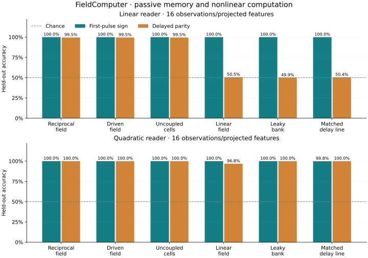

# FieldComputer

This tested adaptation of the archived field retained readable history and performed nonlinear delayed-parity classification. Its incremental response to a common probe also carried history information. No comparative advantage for reciprocal coupling was established. The driven field and uncoupled nonlinear cells matched its passive scores; spatial interactions and scout feedback were unnecessary on these tasks.

A reproducible numerical investigation of Antti’s archived scout/field program, with sparse readers and matched controls.



- [Measured report](REPORT.md) — all gates, seed ranges, and limits.
- [Frozen protocol and correction](PROTOCOL.md) — inputs, controls, thresholds.
- [Complete results](results/results.json) — every seed and reader.
- [Original archive](archive/scout_com_instanton2.py) and [provenance](archive/PROVENANCE.md).
- [Execution record](EXPERIMENT_LOG.md).

```bash
python -m pip install -r requirements.txt
OPENBLAS_NUM_THREADS=1 OMP_NUM_THREADS=1 MPLBACKEND=Agg python -m unittest discover -s tests -v
OPENBLAS_NUM_THREADS=1 OMP_NUM_THREADS=1 MPLBACKEND=Agg python -m fieldcomputer.experiment
MPLBACKEND=Agg python -m fieldcomputer.report
```

The original GUI can be run with `python archive/scout_com_instanton2.py`. `index.html` displays the measured report through the existing Pages workflow. A smaller `--smoke` execution check is available; its outputs are not research results.

The strongest claim evaluated here is comparative value. Passing memory or parity gates alone does not establish that advantage.
